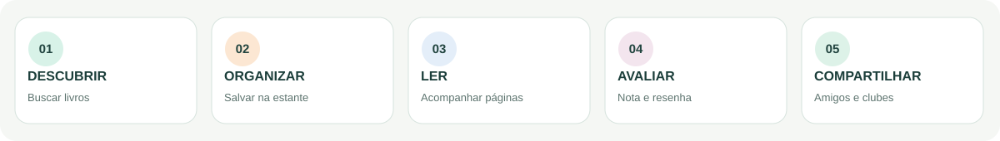
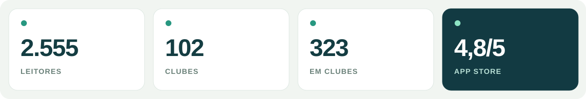
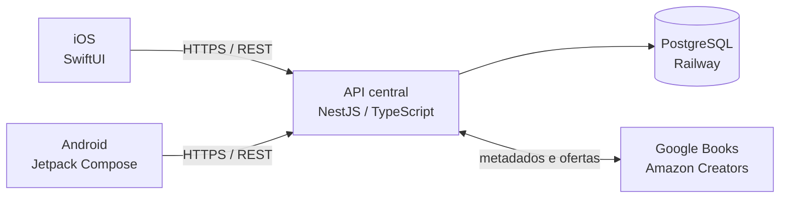

**BookLog** é um aplicativo de organização de leituras e comunidade literária, desenvolvido para iOS e Android. Aqui estão as decisões, a arquitetura e os artefatos de **Laboratório de Engenharia de Software**.

**[Conhecer o projeto](docs/entregas/atualizacao-2026-11-19.md)** · **[Instalar no iPhone](https://apps.apple.com/br/app/booklog/id6811496005)** · **[Explorar a documentação](docs/README.md)**

| iOS | Android | Backend |
| --- | --- | --- |
| **Publicado na App Store** | **Beta em testes** | **API em operação no Railway** |

## Da ideia ao aplicativo

Antes de pensar em clubes ou recomendações, o problema era simples: um leitor podia registrar seus livros em um lugar, suas páginas em outro e conversar sobre eles em um terceiro. O BookLog aproxima essas atividades sem substituir o livro ou o leitor de e-books.



| Descoberta e biblioteca | Registro e comunidade |
| --- | --- |
| Buscar livros por título, autor ou ISBN, consultar detalhes e salvar em estantes. | Acompanhar páginas, histórico e estatísticas; avaliar, publicar, seguir amigos e participar de clubes. |
| **Funcionalidades:** catálogo, status de leitura, listas e organização pessoal. | **Funcionalidades:** feed, resenhas, metas, grupos, ranking e recomendações. |

**[Como usar, do primeiro acesso à comunidade](docs/entregas/atualizacao-2026-11-19.md)**

## Resultados do lançamento



O BookLog chegou ao **Top 6 da categoria Livros da App Store brasileira**, segundo registro histórico da equipe. A classificação oscila e **não representa a posição de hoje**. Os indicadores acima são de **19/11/2026**; a nota de 4,8/5 correspondia a **20 avaliações**.

**[Origem, data e limites dos indicadores](docs/10-resultados/indicadores-2026-11.md)**

## Engenharia por trás do produto



Os dois aplicativos são **nativos** e compartilham uma API. No backend, controllers e DTOs recebem e validam requisições; services concentram regras de negócio; repositories acessam dados persistentes. No Railway, produção e homologação utilizam serviços e bancos distintos.

| Área | Implementação | Evidência pública |
| --- | --- | --- |
| iOS | Swift, SwiftUI, DTOs e repositórios | [Código Swift selecionado](docs/09-codigo-publico/README.md#ios) |
| Android | Kotlin, Jetpack Compose e camadas por feature | [Código Kotlin selecionado](docs/09-codigo-publico/README.md#android) |
| API | NestJS, TypeScript, contratos REST e PostgreSQL | [Código TypeScript selecionado](docs/09-codigo-publico/README.md#backend) |
| Infraestrutura | Railway, produção, homologação, site e serviços de apoio | [Diagrama real de implantação](docs/06-arquitetura/diagrama-implantacao.md) |

**[Arquitetura](docs/06-arquitetura/visao-arquitetural.md)** · **[Requisitos](docs/02-requisitos/requisitos-funcionais.md)** · **[Casos de uso](docs/03-casos-de-uso/README.md)** · **[Modelo de dados](docs/05-modelagem/modelo-dados.md)**

## Estrutura e validação

```text
docs/
├── 01-visao-produto/      problema, proposta e personas
├── 02-requisitos/         RF, RNF, regras e rastreabilidade
├── 03-casos-de-uso/       fluxos da primeira entrega
├── 04-design/             jornada e wireframes
├── 05-modelagem/          domínio e dados
├── 06-arquitetura/        componentes, implantação e decisões
├── 07-sprints/            histórico das etapas
├── 08-operacao/           ambiente e entrega
├── 09-codigo-publico/     seis exemplos reais revisados
├── 10-resultados/         indicadores e metodologia
└── entregas/              baseline e atualização de novembro
```

A verificação deste repositório é **documental**: links internos, arquivos, referências, estrutura e proteção contra segredos. Ela não substitui o build nem os testes dos projetos privados.

```bash
git clone https://github.com/GabrielBuck/Lab-engenharia-de-software.git
cd Lab-engenharia-de-software
node scripts/validate-docs.mjs
```

Requer Node.js 22+. [Plano de testes](tests/plano-testes.md) · [Validação e limites](docs/09-codigo-publico/validacao-e-limites.md)

## Equipe acadêmica

**Gabriel Nottoli Buck** · RA 10425384  
**Julia Andrade** · RA 10427828

Aplicativo desenvolvido em colaboração com a equipe do BookLog; os exemplos iOS preservam a autoria original dos arquivos.

---

**[App Store — BookLog para iOS](https://apps.apple.com/br/app/booklog/id6811496005)** · Android em beta · Atualizado em 19/11/2026
