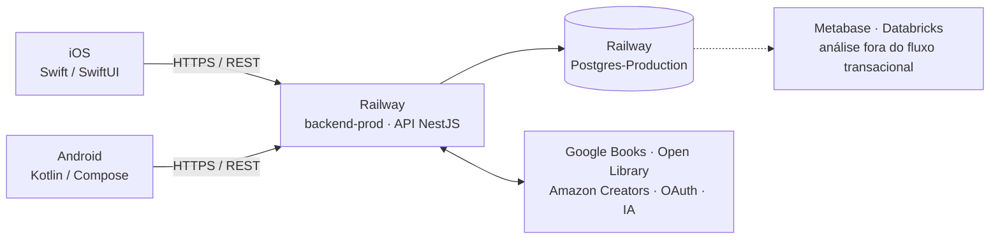

# BookLog


[](https://github.com/GabrielBuck/Lab-engenharia-de-software/actions/workflows/ci.yml)

**Portfólio público · Laboratório de Engenharia de Software · Snapshot 01/10/2026**

BookLog é uma plataforma mobile para organizar leituras e conectar leitores. O produto combina biblioteca pessoal, catálogo, avaliações, feed social, clubes, recomendações e recursos de segurança em clientes nativos iOS e Android apoiados por uma API central.

Este repositório não é um “Hello World” nem um fork da implementação. Ele representa publicamente o estado funcional e arquitetural do projeto oficial, preservando a documentação acadêmica, a rastreabilidade e os limites de segurança.

**[Estado atual e delta](docs/estado-atual.md)** · **[Arquitetura](docs/06-arquitetura/visao-arquitetural.md)** · **[Contrato da API](docs/06-arquitetura/contratos-api.md)** · **[Documentação completa](docs/README.md)**

## O produto hoje

- cadastro, sessão, OAuth, recuperação de senha e autenticação em dois fatores;
- catálogo com resolução de livros, detalhes, tendências, categorias e compra afiliada;
- biblioteca com status, progresso, histórico, estatísticas, estantes e importação CSV;
- avaliações e reviews com notas em incrementos de meia estrela;
- feed com posts, imagens, comentários e curtidas;
- perfis, seguidores, amizades, privacidade, bloqueios e denúncias;
- clubes com membros, convites, mensagens, posts, metas, progresso e ranking;
- empréstimos entre amigos, anotações, notificações e recomendações;
- compartilhamento visual nos clientes e fluxo de OCR no Android.

O [mapa de requisitos](docs/02-requisitos/requisitos-funcionais.md) distingue a baseline da primeira entrega das capacidades sincronizadas depois dela.

## Arquitetura



O backend é um monólito modular em camadas: controllers e DTOs formam a fronteira HTTP, services concentram regras de negócio e repositories abstraem PostgreSQL/adapters de teste. A implantação atual usa Railway, com serviços e bancos PostgreSQL separados para staging e produção. Metabase e Databricks consultam os dados para análise e não participam das requisições normais do aplicativo.

## Componentes oficiais auditados

| Componente | Stack | Referência deste snapshot |
| --- | --- | --- |
| Backend | NestJS, TypeScript, PostgreSQL, Docker, Railway | `a2852bc` |
| Android | Kotlin, Jetpack Compose, MVVM/Clean Architecture, Hilt, Retrofit | `b4ed80f` |
| iOS | Swift, SwiftUI, repositórios e serviços tipados | `cafaf44` |

Os hashes servem como evidência temporal da auditoria, não como submodules. A fonte da verdade continua nos repositórios oficiais da organização `Bin4ryLibr4ry`.

## Modelo e contratos

- [Modelo de domínio](docs/05-modelagem/modelo-dominio.md)
- [Modelo de dados e migrations](docs/05-modelagem/modelo-dados.md)
- [Famílias de endpoints](docs/06-arquitetura/contratos-api.md)
- [Decisões arquiteturais](docs/06-arquitetura/decisoes-arquiteturais.md)
- [Matriz de rastreabilidade](docs/02-requisitos/rastreabilidade.md)

## Ambiente de desenvolvimento

Para validar este portfólio:

```bash
git clone https://github.com/GabrielBuck/Lab-engenharia-de-software.git
cd Lab-engenharia-de-software
node scripts/validate-docs.mjs
```

Requer Node.js 22 ou superior e não instala dependências. O guia de [ambiente de desenvolvimento](docs/08-operacao/ambiente-desenvolvimento.md) registra os comandos reais do backend, Android/iOS e as categorias de configuração. O arquivo [`.env.example`](.env.example) contém somente placeholders; valores reais nunca pertencem a este repositório.

## Organização

```text
docs/
├── estado-atual.md             Snapshot, referências e matriz de evolução
├── entregas/                   Registro histórico das entregas
├── 01-visao-produto/           Problema, valor e personas
├── 02-requisitos/              Requisitos, regras e rastreabilidade
├── 03-casos-de-uso/            Recorte narrativo da primeira entrega
├── 04-design/                  Jornada e wireframes históricos
├── 05-modelagem/               Domínio e dados persistentes
├── 06-arquitetura/             Componentes, contratos, implantação e ADRs
├── 07-sprints/                 Evolução documental
└── 08-operacao/                Ambiente e fluxo de entrega
tests/                          Plano público de verificação
scripts/                        Validação documental
.github/workflows/              CI do portfólio
```

## Equipe

| Integrante | RA |
| --- | --- |
| Gabriel Nottoli Buck | 10425384 |
| Julia Andrade | 10427828 |

## Segurança e limites

O portfólio não publica segredos, dados pessoais, URLs internas, IDs de conta cloud, certificados, bancos ou logs. Também não duplica o código dos repositórios oficiais, evitando uma quarta implementação divergente. Veja [fontes, premissas e limites](docs/fontes-e-premissas.md).

O [guia de contribuição](CONTRIBUTING.md) descreve o fluxo de atualização e revisão.
