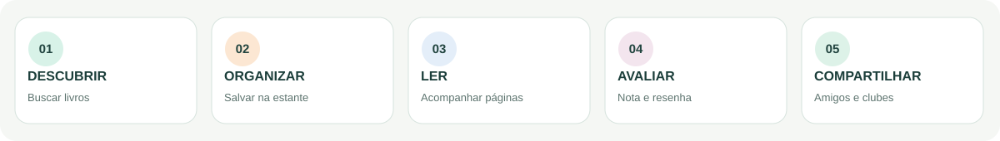

# Visão do produto

**BookLog** é um aplicativo nativo de organização e descoberta de livros com uma camada social para leitores. Em novembro de 2026, o iOS está publicado na App Store e o Android em beta.

## Problema observado na concepção

Listas de livros, progresso de leitura e conversas com outros leitores frequentemente ficam em ferramentas distintas. A proposta do BookLog é reunir esse percurso em uma experiência contínua. Essa descrição é uma **hipótese de produto**, não uma estatística populacional.

## Valor para o leitor

- Guardar livros desejados, em andamento e concluídos.
- Registrar progresso, histórico, metas e avaliações.
- Descobrir títulos, consultar informações e recomendações.
- Interagir com amigos, avaliações, clubes e desafios.

O BookLog não entrega o conteúdo integral dos e-books: o foco é **organizar e compartilhar a experiência** de leitura.

## Escopo técnico

Duas aplicações nativas compartilham uma API NestJS/TypeScript, que valida contratos e guarda dados em PostgreSQL. A execução operacional utiliza Railway, com separação de serviços de produção e homologação.

## Evolução acadêmica

Os [casos de uso](../03-casos-de-uso/README.md) registram a primeira entrega de setembro. A [atualização de novembro](../entregas/atualizacao-2026-11-19.md) descreve o produto ampliado, o lançamento e os indicadores disponíveis.

[← Índice](../README.md)
