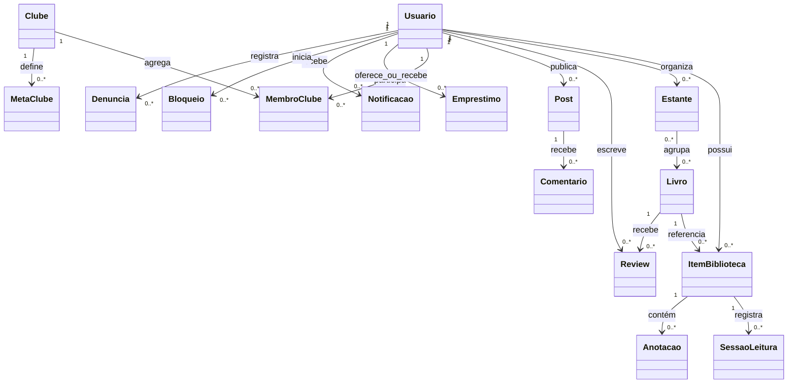

# Modelo de domínio

Modelo conceitual sincronizado com o domínio persistente atual. Ele resume responsabilidades e relações; nomes de colunas e detalhes de migrations estão no [modelo de dados](modelo-dados.md).

| Entidade | Responsabilidade |
| --- | --- |
| Usuário | Identidade, preferências, consentimento e visibilidade do leitor |
| Livro | Metadados de uma edição e proveniência do catálogo |
| ItemBiblioteca | Relação usuário/livro, status, nota pessoal e progresso |
| SessãoLeitura | Evento de progresso que compõe o histórico de leitura |
| Estante | Organização personalizada de livros da biblioteca |
| Review | Avaliação textual e nota de um usuário para um livro |
| Post / Comentário | Conteúdo e interação no feed social |
| Clube / MembroClube | Comunidade, papéis, metas, progresso e pontuação |
| Empréstimo | Ciclo de empréstimo de livro entre usuários |
| Anotação | Registro privado associado a um item de biblioteca |
| Notificação | Evento entregue a um usuário e seu estado de leitura |
| Bloqueio / Denúncia | Controles de segurança, confiança e moderação |

## Invariantes

O par usuário/livro ativo é único (RN003). Cada item pertence a exatamente um usuário e referencia exatamente um livro. O total de páginas pode ser desconhecido; nesse caso o percentual não é calculado. Página atual segue RN005 e notas seguem RN008.

Credenciais, refresh tokens, recuperação de senha, estado de 2FA e tokens de push ficam fora do diagrama de produto. O backend armazena apenas representações adequadas ao mecanismo de segurança; senhas e códigos nunca devem aparecer em texto puro ou em documentação pública.

Veja a [sequência de progresso](diagrama-sequencia/registrar-progresso.md) e o [modelo de dados persistente](modelo-dados.md).

---

[Índice da documentação](../README.md) · [Página do projeto](../../README.md)
