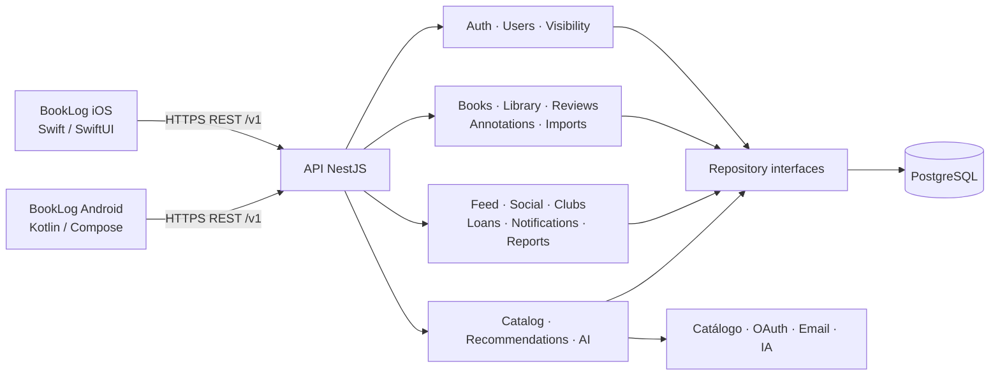

# Diagrama de componentes

Visão lógica do sistema atual, reduzida aos limites relevantes para exposição pública.

---

[Índice da documentação](../README.md) · [Página do projeto](../../README.md)
