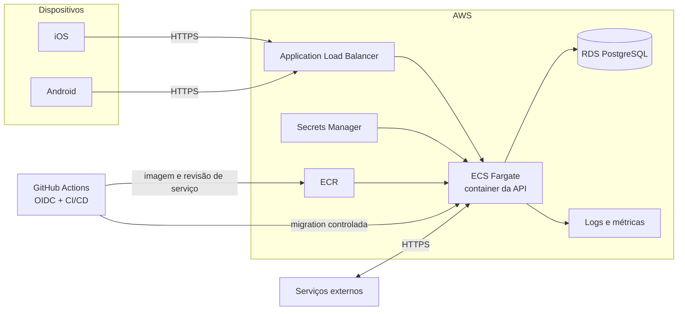

# Diagrama de implantação

Topologia implementada, sem identificadores, endereços ou nomes internos da conta cloud.

Staging e produção usam configurações separadas. O pipeline valida a revisão exata, constrói uma imagem imutável, executa a migration como tarefa única, atualiza o serviço e verifica readiness. O banco não é exposto diretamente aos clientes.

No desenvolvimento local, Docker Compose oferece API e PostgreSQL. Em dispositivo físico, a URL deve apontar para um host alcançável; `localhost` no dispositivo não representa a máquina do backend.

---

[Índice da documentação](../README.md) · [Página do projeto](../../README.md)
