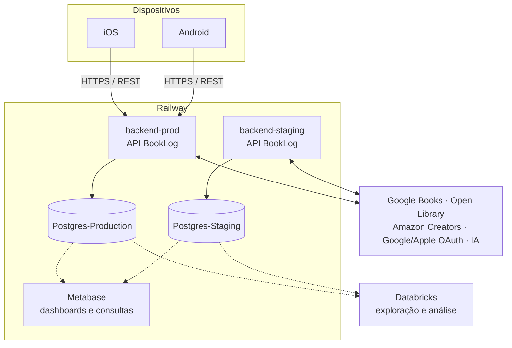

# Diagrama de implantação

Topologia atual, sem credenciais, endereços privados ou identificadores internos.

O fluxo transacional é **usuário → iOS/Android → backend no Railway → PostgreSQL → resposta → aplicativo**. As integrações externas são chamadas pelo backend, não diretamente pelos clientes.

Staging e produção usam serviços e bancos separados. Alterações são validadas em `backend-staging` com `Postgres-Staging` antes de chegarem a `backend-prod` e `Postgres-Production`. As migrations são executadas como etapa controlada, e o endpoint `/v1/health/ready` verifica a conexão com o banco.

Metabase consulta os bancos para dashboards e análises. Databricks é usado para exploração analítica por meio do plano de estudante e fica fora do caminho transacional: sua indisponibilidade não impede o funcionamento do aplicativo. Os bancos não são expostos diretamente aos clientes.

No desenvolvimento local, Docker Compose oferece API e PostgreSQL. Em dispositivo físico, a URL deve apontar para um host alcançável; `localhost` no dispositivo não representa a máquina do backend.

---

[Índice da documentação](../README.md) · [Página do projeto](../../README.md)
