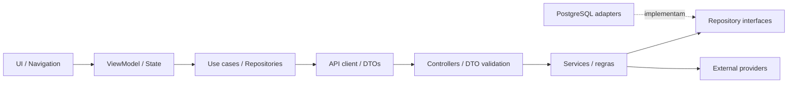

# Diagrama de pacotes

Organização lógica dos clientes e do backend atual.

Dependências concretas são resolvidas pela composição dos módulos. Regras críticas de autorização, privacidade e integridade permanecem no backend; os clientes concentram experiência, estado de tela e adaptação do contrato.

---

[Índice da documentação](../README.md) · [Página do projeto](../../README.md)
