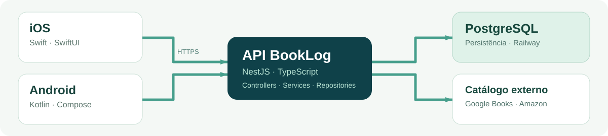

# Arquitetura e Railway — 19/11/2026

Os clientes nativos iOS e Android consomem uma API NestJS/TypeScript. A API recebe e valida DTOs, aplica regras de negócio e persiste em PostgreSQL.

A separação de serviços, bancos e a relação completa de implantação estão no [diagrama de implantação atualizado](diagrama-implantacao.md).

Os diagramas são explicativos; os nomes dos serviços foram conferidos no Railway. A instância do aplicativo não depende de ferramentas de BI para atender uma requisição.

**Exemplo documentado:** ao registrar progresso, o cliente envia dados à API; a validação do [DTO de progresso](../09-codigo-publico/backend/update-progress.dto.ts) exige páginas não negativas e, se informado, tempo entre 1 e 1.440 minutos. O backend trata autorização e persistência.

[Estado atual](../estado-atual.md) · [← Índice](../README.md)
