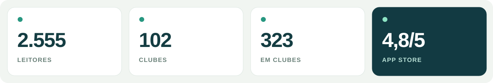

# BookLog em números — 19/11/2026

| Indicador | Registro apresentado | Origem |
| --- | ---: | --- |
| Leitores | **2.555** | Captura do painel público compartilhada em 19/11/2026 |
| Clubes | **102** | Mesmo registro |
| Leitores em clubes | **323** | Mesmo registro |
| Avaliação do iOS | **4,8/5** | Captura da página do aplicativo na App Store |
| Avaliações | **20** | Mesma captura |
| Classificação em Livros | **Top 6 histórico** | Marco informado pela equipe |

**Leitura correta:** são dados datados, não contadores em tempo real. O ranking muda (outro registro mostrava #21). A posição Top 6 não é uma afirmação de classificação atual; os dados não demonstram downloads nem usuários ativos mensais.

## Distribuição

- **iOS:** [BookLog na App Store](https://apps.apple.com/br/app/booklog/id6811496005).
- **Android:** beta em testes no período analisado.

[← Índice](../README.md)
