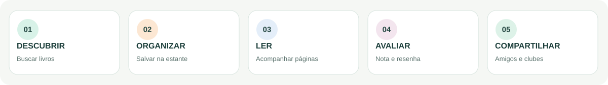
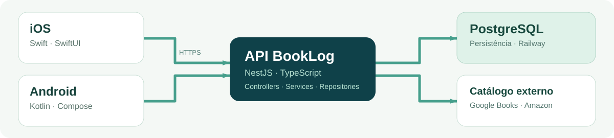
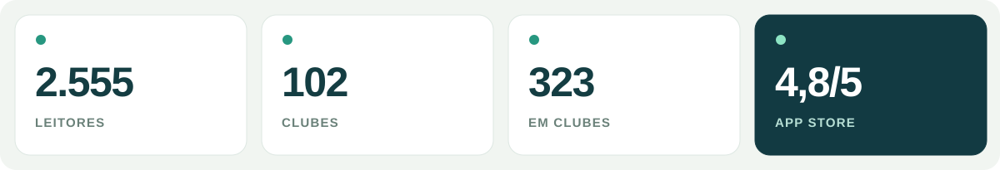

# BookLog — entrega de novembro de 2026

**Laboratório de Engenharia de Software · Gabriel Nottoli Buck e Julia Andrade**

## Por que o BookLog existe

Organizar livros, lembrar onde parou e conversar sobre leituras eram tarefas dispersas. O BookLog reúne descoberta, biblioteca, progresso e comunidade. **Ele não é um leitor de e-books.**

## Como uma pessoa usa o app

1. **Entrar:** criar conta e configurar o perfil.
2. **Encontrar:** buscar um título, autor ou ISBN e ver detalhes.
3. **Guardar:** adicionar à biblioteca e escolher o status de leitura.
4. **Acompanhar:** atualizar páginas, histórico e estatísticas.
5. **Avaliar:** dar nota e escrever resenha.
6. **Compartilhar:** seguir amigos, publicar e participar de clubes e desafios.

O roteiro de demonstração para a disciplina é **buscar → salvar → registrar progresso → interagir**.

## Arquitetura do produto

| Camada | Solução |
| --- | --- |
| iOS | Swift e SwiftUI |
| Android | Kotlin e Jetpack Compose |
| API | NestJS, TypeScript, controllers, DTOs e services |
| Persistência | PostgreSQL, acessado via backend |
| Hospedagem | Railway, com serviços e bancos próprios para operação e homologação |
| Fontes externas | Google Books e Amazon Creators, conforme a funcionalidade |

[Diagrama de implantação real](../06-arquitetura/diagrama-implantacao.md) · [Arquivos reais de código](../09-codigo-publico/README.md)

## Resultados apresentados em 19/11/2026

O time registrou um **pico histórico no Top 6 de Livros da App Store brasileira**. Ranking não é fixo; outro registro mostrava #21. A nota de 4,8/5 tinha 20 avaliações na captura. [Metodologia e datas](../10-resultados/indicadores-2026-11.md).

## Disponibilidade

**iOS:** [instalar na App Store](https://apps.apple.com/br/app/booklog/id6811496005).  
**Android:** beta em testes, ainda sem anúncio de lançamento geral.

## Engenharia e verificação

A documentação pública cobre requisitos, UML, rastreabilidade, testes planejados, decisões arquiteturais e implantação. Os seis [exemplos de código](../09-codigo-publico/README.md) foram copiados de fontes oficiais e revisados, mas **não formam um aplicativo compilável**. A [validação da documentação](../09-codigo-publico/validacao-e-limites.md) é distinta dos testes de software da operação privada.

[← Índice](../README.md)
